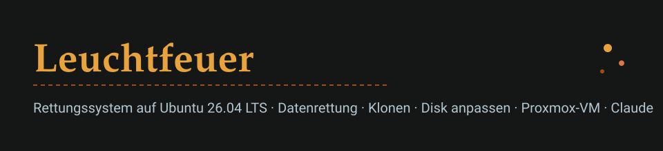

<p align="center"></p>

Leuchtfeuer ist ein bootfähiges Rettungssystem auf Basis von **Ubuntu 26.04 LTS**. Es ist mit allen Updates gebaut und bringt die wichtigen Werkzeuge mit. Ein Assistent führt Schritt für Schritt durch vier Aufgaben:

- **Datenrettung** von defekten Disks. Zuerst entsteht immer ein Image auf einer Ziel-Disk, dann geht es mit dem Image weiter. Für Disks, die nach kurzer Zeit hängen, gibt es einen eigenen Modus: kurze Timeouts, Weiterlesen hinter der Hängerstelle, Warten auf genau dieselbe Disk.
- **Klonen**, z. B. von HDD auf SSD. Die Größe wird automatisch angepasst, auch auf kleinere Ziele.
- **Disk anpassen**: Partitionen vergrößern oder verkleinern, GPT reparieren, sicher löschen.
- **Umzug in eine Proxmox-VM** (P2V): Die Disks des Rechners gehen über das Netz in eine neue VM auf einem Knoten von Proxmox VE. Kopiert werden nur belegte Bereiche, die Volumes bleiben dünn.

Leuchtfeuer hieß bis November 2026 **firestrike-rescue**. GitHub leitet alte Links und Klone auf dieses Repo um. Eine Beta lang gelten die alten `frs`-Befehle weiter, und ein persistenter Speicher mit dem alten Namen `FRS-DATA` wird wie `LF-DATA` verwendet. Rettungsfälle im alten Ordner `FRS/` auf einer Ziel-Disk lassen sich fortsetzen.

**Claude** ist an Bord, als Claude Code CLI und als Claude Desktop. Auf dem Stick gibt es einen kleinen, verschlüsselten Speicher für Configs, `CLAUDE.md` und Logins.

Herunterladen
-------------

Fertige ISOs gibt es unter [Releases](../../releases). Jeden Monat entsteht automatisch ein neuer Build mit allen Ubuntu-Updates.

Die ISO kommt **im DD-Modus** auf einen USB-Stick. Empfohlen sind mindestens 8 GB, damit Platz für den persistenten Speicher bleibt.

- **Windows:** [Rufus](https://rufus.ie). ISO wählen, Rufus fragt nach dem Modus, „DD-Image“ wählen.
- **Linux/macOS:** `sudo dd if=leuchtfeuer-*.iso of=/dev/sdX bs=4M status=progress conv=fsync`
- So prüfst du die Herkunft: `gh attestation verify leuchtfeuer-*.iso --repo Celestial0579/leuchtfeuer`
- Ältere Betas bis `v26.04-20261115.6-beta` heißen noch `firestrike-rescue-*.iso`. Ihre Herkunft prüfst du mit dem alten Repo-Namen, unter dem sie gebaut wurden: `gh attestation verify firestrike-rescue-*.iso --repo Celestial0579/firestrike-rescue`

Der Stick startet per UEFI (auch mit Secure Boot) und per Legacy-BIOS.

Nach dem Beschreiben zeigt der Stick ein kleines Laufwerk `LF-SSH`. Dort kannst du eine Datei `authorized_keys` mit deinen öffentlichen SSH-Schlüsseln ablegen ([Anleitung, Fernzugriff](docs/anleitung.md#fernzugriff)).

Bedienung
---------

Nach dem Start erscheint der Assistent und zeigt alle Disks mit ihrem SMART-Zustand. Er schlägt dann den passenden Weg vor. Die ausführliche Anleitung steht in [docs/anleitung.md](docs/anleitung.md). Was an echter Hardware noch zu prüfen ist, steht in [docs/hardware-pruefung.md](docs/hardware-pruefung.md).

```
GERÄT     ZUSTAND  MODELL                       GRÖSSE     SERIENNUMMER         BUS
sda       [DEFEKT] WDC WD10EZEX-08WN4A0         931.5GiB   WD-WCC6Y0ABCDEF      sata
          12 schwebende Sektoren, 140 Lesefehler im Kernel-Log
nvme0n1   [OK]     Samsung SSD 990 PRO 2TB      1.8TiB     S7DNNJ0W123456       nvme
```

Diese Schutzregeln gelten immer:

- Quell-Disks werden sofort auf Kernelebene schreibgeschützt.
- Ziele werden über die Seriennummer bestätigt. Du gibst die letzten 4 Zeichen ein, nicht `/dev/sdX`. Meldet eine Disk keine Seriennummer, nimmt der Assistent stattdessen die WWN. Fehlt auch die, verlangt er Gerätename und Größe. Eine leere Eingabe bestätigt nie.
- Eine Kennung zählt nur, wenn sie eindeutig ist. Melden zwei angeschlossene Disks dieselbe Seriennummer (baugleiche USB-Adapter tun das oft), stehen beide unter ihrem Gerätenamen und werden über Gerätename und Größe bestätigt.
- Bestätigt wird genau das Gerät, auf das danach geschrieben wird. Ändert sich sein Name, solange der Dialog offen ist, bricht der Schritt ab. Der Klon prüft vor jeder Partition, dass Quelle und Ziel noch dieselben Disks sind.
- Fremde Disks werden nie automatisch eingehängt, auch nicht beim Booten: Das Live-System wird nur auf dem Stick gesucht. Swap, RAID und LVM werden nicht automatisch aktiviert.
- Reparaturen laufen nur auf einer Kopie des Images.
- Von welcher Disk gelesen wird, bestimmst du. Beim Fortsetzen wählst du die Quelle neu. Die Falldatei auf der Ziel-Disk kann deiner Wahl nur widersprechen.
- Ein Ziel wird ohne Geräte-, Setuid- und Programmrechte eingehängt (`nodev,nosuid,noexec`). Verknüpfungen darauf werden nicht verfolgt (`nosymfollow`). Für Partitionen aus einem Image gilt dasselbe, und sie sind nur lesend eingehängt.
- Namen von Datenträgern bleiben Namen. Fallordner werden nur mit Namen aus Buchstaben, Ziffern, Punkt, Unterstrich und Bindestrich angeboten, und kein Menüeintrag wird als Option gelesen. Label und Partitionsnamen der Quelle kommen nur geprüft in den Klon-Job.
- Texte von Datenträgern sind auch für Claude Daten, keine Anweisungen. Was die Geräte melden, steht in einer Datendatei (`zustand.txt`), nicht in einer `CLAUDE.md`. Eine `CLAUDE.md`, Hooks, Skills oder ein MCP-Server von einem eingehängten Datenträger gelten nicht.
- Was ein Datenträger über sich meldet (Modell, Label, Partitionsname), steht in Dialogen nur gefiltert: sichtbare Zeichen, alles andere als `?`. Eine Seriennummer mit anderen Zeichen gilt nicht als Kennung. Auch die Ausgabe von Werkzeugen wie fsck erreicht Bildschirm und Protokoll ohne Steuerzeichen.
- Die Suche nach Rettungsfällen schreibt nicht. Die gewählte Disk ist dabei schreibgeschützt und nur lesend eingehängt, bis du einen Rettungsfall gewählt hast.
- Beim Umzug in eine VM verbindet sich ssh nur mit dem Schlüssel des Knotens, den du über seinen Fingerabdruck bestätigt hast. Zugangsdaten speichert der Assistent nicht. Geschrieben wird nur in die Volumes einer neuen VM, deren ID du abtippst. Die Daten laufen über Unix-Sockets, kein Netzport, an dem ein anderer Benutzer in die Volumes schreiben könnte.
- SSH ist nach dem Start aus. Eigene Schlüssel liest Leuchtfeuer nur lesend von der Partition `LF-SSH` des Sticks, von dem gestartet wurde, und sie gelten erst, wenn du sie beim Einschalten bestätigst. Gilt ein Schlüssel, gilt kein Passwort.
- Der persistente Speicher ist nur die Partition `LF-DATA` auf dem Stick, von dem gestartet wurde. Unverschlüsselt wird er erst nach einer Rückfrage eingebunden, und `lf.conf` wird gelesen, nicht ausgeführt.
- Für Claude sind die wichtigsten Regeln gesperrt statt nur aufgeschrieben. Den Schreibschutz einer Disk aufheben, die Sperre anfassen oder das Original-Image reparieren kann Claude nicht. Jeden schreibenden Befehl bestätigst du selbst, und keine Rückfrage lässt sich dauerhaft abschalten. Auto-Modus und Modus ohne Rückfragen gibt es nicht.
- Kein Programm kann sich per ptrace an ein anderes hängen, auch root nicht: ptrace ist ab dem Start gesperrt (`kernel.yama.ptrace_scope=3`).
- Kein Kernel lässt sich per kexec laden, auch nicht von root: kexec ist ab dem Start gesperrt (`kernel.kexec_load_disabled=1`).
- Nach einer Claude-Freigabe bleibt Claude bis zum Neustart gesperrt, und eine neue Freigabe gibt es erst danach. Sicher endet root-Zugriff nur mit dem Ausschalten am Netzschalter.

Was ist drin
------------

| Bereich | Werkzeuge |
|---|---|
| Rettung | ddrescue, ddrescueview, safecopy, testdisk/photorec, foremost, sleuthkit, ewf-tools |
| Diagnose | smartmontools, nvme-cli, hdparm, memtester, memtest86+, stress-ng, lshw |
| Klonen | partclone, fsarchiver, clonezilla, qemu-img (VHDX), wimtools, nbd-client (Umzug in eine VM) |
| Dateisysteme | NTFS, ext2–4, XFS, Btrfs, exFAT, FAT, F2FS, HFS+, LVM, mdadm, LUKS, BitLocker (dislocker) |
| Windows | chntpw, efibootmgr, ms-sys |
| Netz | NetworkManager (nmtui, WLAN), SSH (auf Wunsch), rsync, rclone, SMB, NFS (v4, v3 mit `nolock`) |
| Claude | Claude Code CLI, Claude Desktop (offizielles Anthropic-Paket, Linux-Beta) |

Selbst bauen
------------

Den Build übernimmt GitHub Actions (`.github/workflows/build.yml`). Lokal braucht es einen Ubuntu-26.04-Host oder Docker, am besten mit demselben Basis-Image wie in der CI:

```bash
docker run --rm --privileged -v "$PWD:/src" "$(sed -n 's/^FROM //p' build/Dockerfile)" /src/build/build.sh
```

Die ISO landet in `out/`.

Der Build hängt nur an festgelegten Fassungen. Das Basis-Image steht per Digest in `build/Dockerfile`, Dependabot schlägt neue Digests vor. Die Claude Code CLI steht mit Fassung und sha256 in `build/chroot-setup.sh` (`CLAUDE_CLI_VERSION`, `CLAUDE_CLI_SHA256`, Werte aus `https://downloads.claude.ai/claude-code-releases/<Fassung>/manifest.json`, Plattform `linux-x64`). Eine neue Fassung kommt nur mit einem Commit. Das `.manifest` des Releases nennt beide. Neue stabile Fassungen der CLI meldet der Workflow `claude-cli.yml` wöchentlich als Issue, mit Fassung und sha256 nur aus einem Manifest, dessen Signatur der Anthropic-Schlüssel mit dem Fingerabdruck aus `build/chroot-setup.sh` bestätigt (`build/cli-fassung.sh`).

| Datei | Zweck |
|---|---|
| `build/build.sh` | debootstrap → chroot → SquashFS → Hybrid-ISO (xorriso) |
| `build/Dockerfile` | Basis-Image des Builds, `ubuntu:26.04` per Digest (nur die FROM-Zeile) |
| `build/packages.list` | Paketliste |
| `build/chroot-setup.sh` | Pakete, Claude (die CLI in fester Fassung, sha256 geprüft), Sicherheits-Defaults |
| `build/grub/` | Bootmenü und Theme |
| `rescue/lf` | Assistent, Bibliotheken in `rescue/lib/` |
| `rescue/claude/CLAUDE.md` | Regeln für Claude im Rettungssystem |
| `rescue/claude/managed-settings.json`, `rescue/bin/lf-claude-guard` | Sperre für Claude: Was die Regeln verbieten, lehnt ein Hook ab. Kein Auto-Modus. Hooks, Erlaubnis-Regeln, Skills, Agenten und MCP-Server nur aus dem Rettungssystem, keine `CLAUDE.md` von einem Einhängepunkt. `rescue/bin/claude` startet die CLI ohne Projekt-Einstellungen (`--setting-sources user`), eine neue Version erst nach `rescue/bin/lf-claude-check`. CLI und Desktop laufen als Benutzer `lf-claude` und dürfen als root nur `rescue/bin/lf-lesen` und `rescue/bin/lf-aufgabe` starten, mehr nur zeitlich begrenzt über `rescue/bin/lf-freigabe` |
| `rescue/claude/skills/` | Skills zur Datenrettung für Claude, verwaltet unter `/etc/claude-code/.claude/skills` |
| `tests/qemu-smoke.sh` | Boot-Tests (UEFI, BIOS, Selbsttest mit simulierter defekter Disk) |

Design
------

Farben und Schriften stammen von [firestrike.de](https://firestrike.de). Sie gelten für das Bootmenü, die Konsole (per `setvtrgb`) und die Dialoge:

| Grund | Text | Stahl | Stahl hell | Funke | Glut | Akzent |
|---|---|---|---|---|---|---|
| `#141715` | `#E8EBE7` | `#33414B` | `#B4C6D1` | `#E8A33D` | `#AB5019` | `#D9713C` |

Lizenz
------

MIT, © 2026 Tim Heyne. Siehe [LICENSE](LICENSE). Die enthaltenen Ubuntu-Pakete und Claude stehen unter ihren eigenen Lizenzen.
